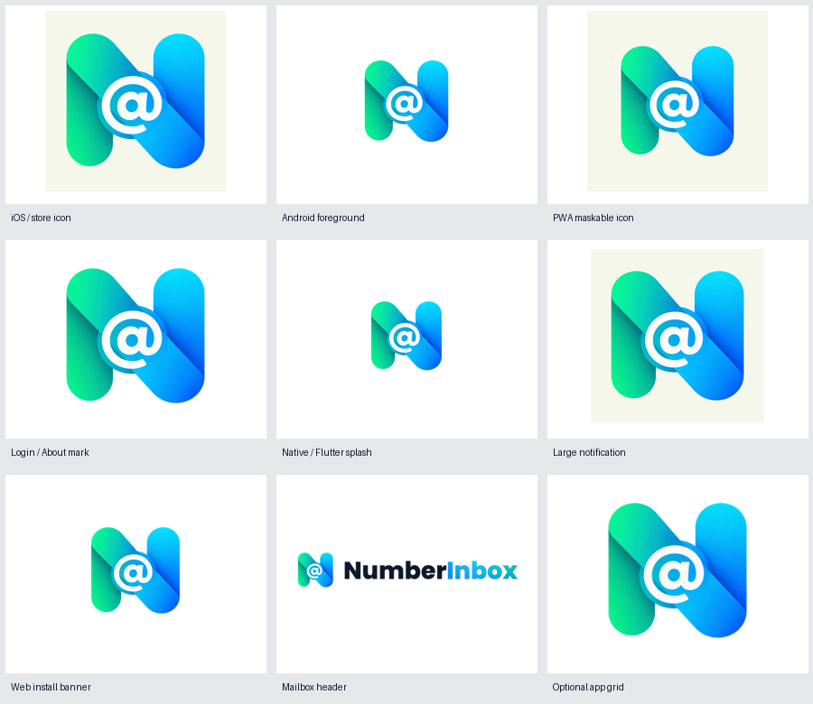

# Branding asset audit — 2026-11-01

Scope: the mobile-app checkout at `52a4145d9` plus the uncommitted detailed-mark
refresh and audit corrections. This is an asset/branding review, not a complete
security review, signed-build verification, or store submission approval.

## Missed surfaces corrected

| Surface | Finding | Correction |
|---|---|---|
| Android large notification | `LocalNotificationConfig` still referenced an older dark-tile mark | Generate `drawable/ic_large_notification.png` from the current unframed store artwork; keep notification payload/privacy logic unchanged |
| Mobile-web install banner | All four `tmail-*x.png` images still used the earlier mark | Generate every density from the shared detailed mark; preserve inherited paths and banner behavior |
| Web-to-Flutter splash | Web painted a 91.875px visible mark while Flutter painted 100.25px | Share the padded splash pixels and 256px canvas; align the wordmark offset with Flutter's existing gap |
| PWA maskable icons | Regular store artwork extended outside the guaranteed safe circle | Generate separately padded maskable icons; preserve full-size regular PWA icons |
| Own-app dashboard branding | Owned entries still selected Twake/TMail icons and one label was TMail | Use the detailed NumberInbox icon and NumberInbox Mail label; retain every existing entry and navigation link |
| Legacy own-app raster paths | Three inherited envelope aliases and `icon_ni_android.png` retained previous artwork | Regenerate those aliases without deleting upstream paths or changing dimensions |
| Favicon | SVG MIME type was `image/svg`, with no linked PNG fallback; the hybrid SVG embedded a store-sized texture | Use `image/svg+xml`, the existing regenerated 32px PNG fallback, and a tab-sized raster in the SVG |
| Installed iOS web app | Metadata explicitly requested a black status bar | Request the normal/default style alongside the existing white web surface; native iOS configuration is unchanged |
| Web administrator guide | It documented retired filenames and suggested replacing only one icon | Document the actual generated assets and the shared export command |
| Adaptive renderer tooling | The refresh added an unnecessary call to a test-only decode helper | Remove it: the pinned public `loadPicture` future already waits for embedded image decoding |

The PWA safe-area check follows the [Web App Manifest safe-zone definition](https://www.w3.org/TR/appmanifest/#icon-masks): important artwork fits the centered circle of radius 40% of the icon size. The iOS web-app metadata correction follows [Apple's documented status-bar styles](https://developer.apple.com/library/archive/documentation/AppleApplications/Reference/SafariHTMLRef/Articles/MetaTags.html).

## Coverage

| Area | Checked |
|---|---|
| App branding | Welcome/OTP mark and wordmark, loading screen, About, web login, shared mailbox/header logo and dialog logo asset consumers |
| Primary actions | Shared gradient token and existing tests for Send code, Verify, Compose (mobile/sidebar), Continue deletion, disabled/loading states, and red destructive confirmation |
| Android | Manifest launcher/round icon references; adaptive mask geometry across densities; legacy launchers; day/night splash resources; large notification; intentionally monochrome small notification |
| iOS/iPad | Every referenced AppIcon and LaunchImage file, actual sizes, opaque store icon, white day/night launch backgrounds, display names and share-extension identity |
| Web/PWA | Manifest icon paths and sizes, mask padding, favicon and fallback, splash geometry/removal wiring, smart-banner density images, app-grid icons, install metadata |
| Typography/colors | Existing outlined wordmarks preserved; no new fonts, app dependencies, button palettes, or broad theme changes |
| Asset integrity | 17 branding SVGs parsed; their embedded images use self-contained PNG data URIs; all native catalog references exist |
| Reproduction | A repeated full generation changed zero files in a 489-file asset/config snapshot |

The source master stays outside Flutter's bundled asset directories. Relative
to HEAD, the refreshed Flutter asset directories contain about 2.44 MiB more raw
data (2,558,051 bytes). This includes the richer raster shading and legacy-path
compatibility copies; it is not an APK download-size measurement. Existing image
canvas dimensions are retained. No new runtime dependency or image-generation
call is introduced into app startup.



## RED / GREEN and regression evidence

- PWA test RED: 2,463 colored pixels in the 192px maskable icon were outside the guaranteed safe circle. GREEN after adding mask-specific padding.
- Web splash RED: 91.875px visible mark versus 100.25px in Flutter, an 8.375px difference. GREEN after sharing the splash canvas and matching its CSS size.
- iOS web metadata RED: requested `black`; the added light-surface configuration test expected `default`. GREEN after the metadata correction.
- The two geometry regression tests passed after their fixes.
- Wider run: **160 tests passed**, **one opt-in capture test skipped**. It covered all `test/branding`, logo assets, app identity, HomeView, welcome/OTP widgets, Compose buttons, account deletion, and light system UI.
- After the final iOS metadata change, the complete web-splash test file passed: **8 tests**. This includes the new metadata case.
- After the compact favicon export, the launcher/PWA and web-splash files passed together: **25 tests**.
- The actual hybrid SVG export and its rendering-helper regression tests passed together: **12 tests**, using only the public loader API.
- Focused analysis of both touched test files and the rendering helper reported **no issues**. The helper itself is now unchanged from HEAD.
- App-grid validation confirmed unchanged entry count and links and verified that every configured icon exists.
- `git diff --check` passed.

The final SVG favicon is 20,933 bytes and embeds a 128×128 texture; the full
store-sized image remains available in the dedicated store/PWA exports.

Commands and local logs:

```sh
flutter test --no-pub test/branding/launcher_icon_test.dart test/branding/web_splash_contract_test.dart --name 'PWA maskable icons|web splash paints' --reporter expanded
flutter test --no-pub test/branding test/assets/logo_assets_test.dart test/app_branding_test.dart test/features/home/presentation/home_view_test.dart test/features/starting_page/twake_welcome_view_test.dart test/features/starting_page/twake_welcome_screen_contract_test.dart test/features/base/widget/compose_floating_button_test.dart test/features/mailbox_dashboard/presentation/widgets/compose_button_widget_test.dart test/features/numberinbox/account_deletion_page_test.dart test/main/light_system_ui_region_test.dart --reporter expanded
flutter test --no-pub test/branding/web_splash_contract_test.dart --reporter expanded
python3 tool/branding/generate_brand_assets.py
git diff --check
```

The local evidence logs are `/tmp/numberinbox-brand-audit-red.log`,
`/tmp/numberinbox-brand-audit-green.log`,
`/tmp/numberinbox-brand-audit-finaltests.log`, and
`/tmp/numberinbox-brand-ios-pwa-{red,green}.log`. The wider command preceded the
last metadata-only correction; the web test file was rerun afterward.

## Intentional exclusions and remaining rollout checks

- **Physical startup:** `splash_handoff_capture_test.dart` requires device frames (`NI_SPLASH_FRAME_DIR`, frame bounds, pixel scale). Its skip is not a verified cold-start handoff. Capture Android/iOS cold starts before release.
- **Website:** sibling `site/assets/numberinbox-mark.svg` and `numberinbox-logo.svg` still contain the preceding artwork. Updating the app's source masters does not publish or update those separate consumer copies. Coordinate that repository's branding manifest/checks and deploy through its normal process.
- **Store screenshots:** existing screenshots show an earlier real build. Recapture logo-bearing screenshots from the final app and review the rest. Do not paint the new logo over an old screenshot or present this contact sheet as app UI.
- **Selected feature banner:** retain the owner's preferred original PNG and its 1024×500 export. The separate `feature-graphic-v2.svg` is a documented unselected design alternative, not the app master.
- **Third-party identity:** Workplace, Drive, Contacts, Calendar and meeting-service artwork and inherited ecosystem integration behavior remain intact. Internal Twake filenames, class names and the TwakeInter font family are compatibility identifiers, not app display branding.
- **Monochrome variants:** small Android notification art and monochrome mark sources stay simplified; raster gradients are not appropriate substitutes for those silhouettes.
- **Legacy unused source files:** the old native wordmark-only branding PNGs, unused Lottie/bootstrap assets, and brand board remain reference/compatibility material. They are not referenced by the current launch configuration or active logo widgets.
- **Localization history:** some ARB files contain obsolete Tmail quota-message entries. Their getters are absent from current `AppLocalizations`, and the current quota widget uses newer generic messages. They are not a demonstrated active branding defect; avoid unrelated upstream translation churn in this refresh.
- **No release action:** no commit, push, app build, installation, website deployment or store upload occurred during this audit.

## Subsequent emulator build verification

At the owner's request after the audit, fresh debug builds succeeded with
`flutter build apk --debug --no-pub` (Java 21) and
`flutter build ios --simulator --debug --no-pub`. They were installed and
launched on Pixel 7 and iPhone 17 Pro Max emulators. The iOS login screen showed
the updated branding. Android retained an existing account and displayed a
mailbox error; account data was not cleared. Installation and launch do not
establish successful mailbox synchronization or a frame-measured splash handoff.
No website deployment or store upload was performed.
