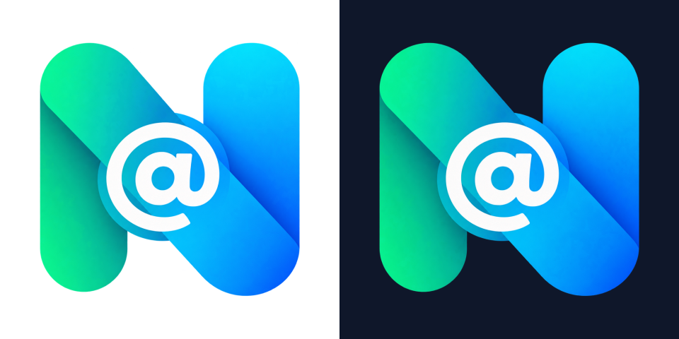

# Detailed NumberInbox mark

Created 2026-11-01 after the owner selected the original AI-generated Play
banner's large N/@ mark. Decision: [ADR 0119](../adr/0119-detailed-numberinbox-brand-artwork.md).

## Source and exports

- Source: `assets/brand/source/mark-detailed.png`, 1254×1254 RGBA, generated with the built-in image generation tool. It is a high-resolution reconstruction of the banner's right-hand mark, not a lossless extraction or a vector tracing.
- Reference: `docs/store/play/feature-graphic-preferred-original.png`. The selected feature graphic itself remains unchanged.
- Build: `python3 tool/branding/generate_brand_assets.py`, with Pillow installed.
- Every derivative shares this one source. Exporting again uses no AI request, external font service, backend connection, or new app dependency.
- In-app logo PNGs, SVG compatibility logos, native and Flutter splashes, native/store launcher icons, web icons, favicon and web splash are updated together.
- SVG compatibility files embed the mark as PNG, preserving its texture and shading. Their wordmark/tagline paths stay vector and retain existing typography. These are explicitly hybrid assets.
- The raw source lives outside bundled asset directories; the app ships appropriately sized derivatives. Runtime SVG marks embed 512px pixels rather than the entire raw master.
- Normalizing the transparent margin uses the existing geometry tests' alpha threshold. A small antialiasing margin is retained; very faint pixels outside the mark do not control its placement.
- Layouts, button colors, ordinary interface icons, monochrome notifications, startup timing, splash themes, and authentication are unchanged.

## Geometry and verification

Existing guards passed: 56 tests covering launcher masks and dimensions, splash
assets and native/Flutter geometry, the adaptive rendering helper, About branding,
and HomeView layout. Command:

```sh
flutter test --no-pub test/branding/launcher_icon_test.dart test/branding/splash_config_test.dart test/branding/adaptive_foreground_renderer_test.dart test/branding/about_attribution_test.dart test/features/home/presentation/home_view_test.dart --reporter compact
```

Measured meaningful-alpha widths: Flutter splash source 100.25dp; iOS 1x and
Android mdpi native stages 101dp. Centers differ by at most 0.5 source pixels.
Adaptive foreground width is about 50dp and maximum radius about 31.2dp, inside
the existing 33dp safe circle. Existing tests also verify all density exports.

These are static rendering and widget checks. They do not replace a cold-start
check on Android/iOS, checking installed launcher masks on a real device, or
recapturing store screenshots. No app build, physical-device check, deployment,
store upload, or website rollout is claimed here.

The actual hybrid adaptive SVG also passed the Flutter rendering helper:

```sh
NUMBERINBOX_ICON_OUTPUT=/tmp/numberinbox-detailed-adaptive-render.png NUMBERINBOX_ICON_PREVIEW_DIR=/tmp/numberinbox-detailed-icon-previews flutter test --no-pub tool/branding/render_adaptive_foreground.dart --reporter expanded
```

That additional test uses the loader's awaited embedded-image decoding, verifies safe geometry,
and produces circular, rounded-square and squircle previews at 48px and 96px.
The helper's side-effect-free tests remain among the 56 checks above.



## Prompt provenance

The built-in image tool produced the isolated mark from the banner reference.
A subsequent cleanup attempt did not improve the visible edges and was not
selected. The first reconstruction is the preserved source; resizing and
surface previews were visually inspected on white and navy backgrounds.

Selected master prompt:

> Use case: background-extraction / precise-object-edit. Edit target: the LARGE N/@ mark on the RIGHT of the attached NumberInbox feature banner, not the smaller logo at upper left. Produce a dedicated high-resolution master of ONLY that large mark, on a genuinely transparent background (RGBA). Preserve the selected large mark's shape, proportions, rounded green left stem, rounded cyan-blue right stem, layered diagonal ribbon, central bold white @, smooth fine-grained green-to-cyan-to-blue gradients, subtle overlaps and highlights as faithfully as possible. Keep the logo front-facing and square in proportion. Remove the entire banner, lettering, background colors/circles, and every other object. Do not introduce a rounded-square tile or icon frame, text, extra rings, watermark, new outlines, extrusions or new decorative elements. The white @ is part of the logo and must remain opaque white; only the area outside and the negative spaces of the N are transparent. Do not cut out the @. Reconstruct the same fine edge quality at high resolution, target 2048 x 2048 pixels with a centered logo occupying about 80% of the canvas and balanced transparent margin on all sides. Keep every part of the N fully visible and uncut. No broad drop shadow, glow, matte, white halo, or solid background; retain only the mark's internal dimensional shading. This is a faithful reusable logo extraction and high-resolution reconstruction, not a redesign. Single isolated mark, no comparison sheet.
